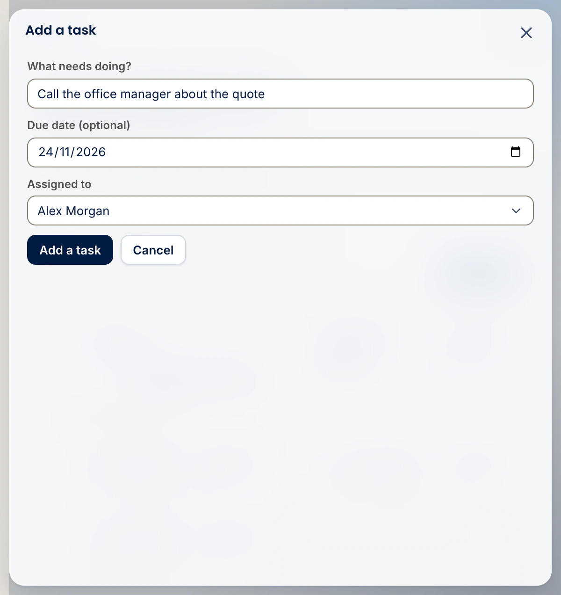

## What it does

You can add a to-do, give it a due date, change it later or delete it. A wide panel opens beside the To-dos drawer for the details. You can also start a chat with Claude about any to-do.

## Why it helps

- Writing it down takes seconds, so you stay in flow.
- Claude can help you plan or finish the job, with the to-do already in front of it.

## How to use it

1. First switch on **Let the app change to-dos** in Settings (**General** tab). Until then you can read to-dos but not change them.
2. Open the To-dos drawer and press **Add a to-do**. The panel opens.
3. Type what needs doing and press **Add a to-do**. Every field shows at once. If you leave the rest blank, it goes to you with no date.
4. After you add one for yourself, the panel stays on it. You can add files from there.
5. On a project's **To-dos** tab, **Add a to-do** fills in the project.
6. To read a to-do, press its title. To change it, press **Edit**, then **Save**. In the details box you can add headings, bullet and numbered lists, tick lists, bold text and links.
7. To tick off a step in a tick list, press its box while you read. It saves at once.
8. Use the up and down buttons at the top to change to-do. **P** and **N** do the same when single-key shortcuts are on.
9. To ask Claude for help, press **Start a chat**. Press **Open chat** later to come back to it.

## Good to know

- Esc closes the panel, even while you type. With unsaved changes, Cortex asks first. It also asks before a chat, another page or another to-do.
- If a teammate changes a to-do while you edit it, Cortex tells you. You choose whether to keep your version or theirs.
- **Delete** and **Mark as done** wait a few seconds, so you can undo them.
- **Working on** on Home fills in the project.
- Very long details, tables, code and quotes can't be edited here. Change those in a chat.

## Try this

Press **Add a to-do**, type "Send Acme Heating the new quote" and press **Add a to-do** again.
