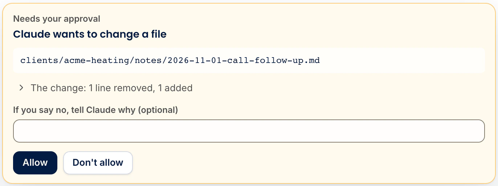

## What it does

Sometimes Claude needs to check with you. It shows a card in the chat. You answer, and Claude carries on.

## Why it helps

- Nothing important changes without your say-so.
- You can say no, and tell Claude what to do instead.
- Claude can ask you when it isn't sure, rather than guess.

## How to use it

There are two kinds of card.

An approval card says **Needs your approval**. It names the thing Claude wants to do, such as change a file.

1. Read what Claude wants to do.
2. Press **Allow** to say yes.
3. Press **Don't allow** to say no. Use **If you say no, tell Claude why (optional)** to explain.

When Claude asks a question, a card shows the answers to pick from. Pick one, or use **Or type your own answer**. Then press **Send answer**. Some questions let you pick more than one.

## Good to know

- Some approval cards also offer **Allow for this chat**. That says yes to this kind of change for the rest of that chat. The card says exactly what it covers.
- Claude waits for you. It does not carry on until you answer.

## Try this

Ask Claude to "Add a line to my notes file", then press **Don't allow** and say why.
