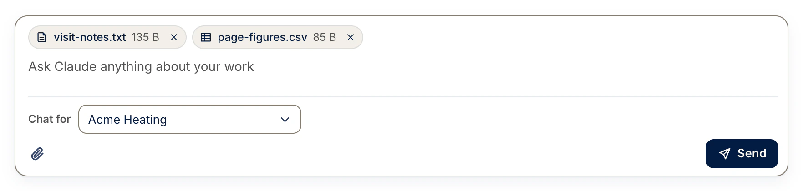

## What it does

You can attach files to a message. Claude reads them, and can file them in the Brain for you.

## Why it helps

- Claude works from the real file, not your summary of it.
- A screenshot can say in a second what would take a paragraph.
- Nobody has to find the right folder. Claude files it.

## How to use it

1. Click the paperclip button under the message box. You can also drop files on the chat, or paste a screenshot.
2. Each file appears as a small tag with its size. Wait for **Uploading** to change to the size.
3. To take a file off, press the cross on its tag.
4. Write your message and press **Send**.

## Good to know

- You can attach up to 10 files to one message. Each can be up to 32 MB.
- Documents, spreadsheets, slides, text files and pictures all work.
- A file Cortex can't pass on shows **Can't attach**. Remove it, then send. Point at the tag to see why.
- A pasted picture is named "Pasted image" with the date and time.
- Send waits until every file has finished uploading.
- You can see everything a chat has used on the [Files tab](help:chat-files).

## Try this

Drop in a spreadsheet and type "Which rows look wrong, and why?"
