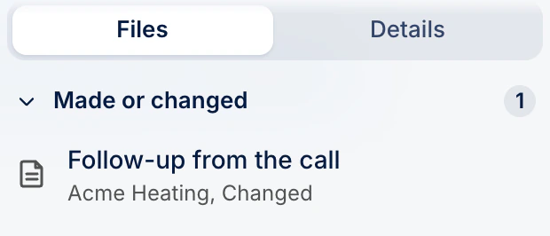

## What it does

The **Files** tab of the [This chat panel](help:this-chat-panel) lists every file a chat used. They sit in groups you can open and close.

## Why it helps

- You can find a file Claude made without scrolling back.
- You can check which files Claude read to reach its answer.
- You can see exactly what Claude changed in a file.

## How to use it

1. Open the **This chat** panel and choose **Files**.
2. Open a group. Each row shows the file, where it lives, and what happened to it, such as Made, Changed, Filed, Mentioned or Read.
3. Click a row to preview the file.
4. Press **Open** to see it large, or **Download** to save a copy. Press **All files** to go back.
5. For a file Claude changed, press **What changed** to see each edit.

The groups are **Made or changed**, **Attached**, **Mentioned in replies**, **Looked at**, **Pages** and **Web links**.

## Good to know

- A file that has since been removed shows "No longer there".
- A file you attached that wasn't filed says "Not filed".
- **What changed** works while the chat is open.
- Pages Claude makes have their own group. See [Pages Claude makes](help:pages-claude-makes).

## Try this

After Claude edits a document, open **What changed** and read the newest edit first.
