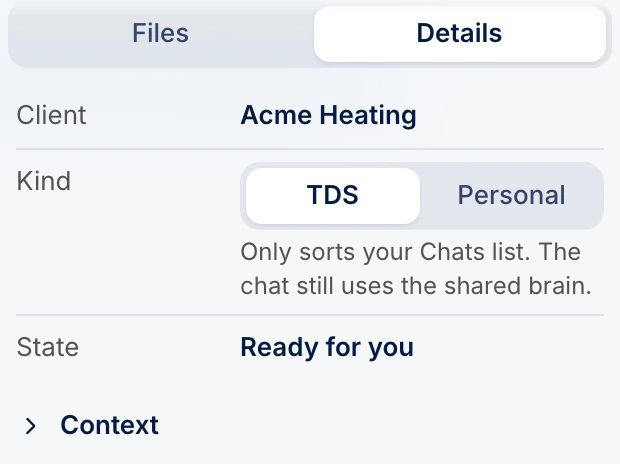

## What it does

Every chat is either **TDS** or **Personal**. The label only sorts your Chats list. It's a way to keep work and your own things apart.

## Why it helps

- You can look at work chats without your own ones in the way.
- A chat about a personal to-do is marked Personal for you.

## How to use it

1. Open the chat.
2. Open the [This chat panel](help:this-chat-panel) and choose **Details**.
3. Next to **Kind**, press **TDS** or **Personal**.
4. In the [Chats drawer](help:chats-drawer), use the **All**, **TDS** and **Personal** switch to filter. It shows once you have a personal chat.

## Good to know

- A new chat starts as TDS. If it begins from a personal to-do, it starts as Personal.
- The change is saved on this computer, and it's kept when you open the chat again.
- The setting only sorts your list. The chat still uses the shared Brain, so Claude can read the same things.

## Try this

Mark a chat about your own plans as **Personal**. Then filter the Chats drawer by **Personal**.
