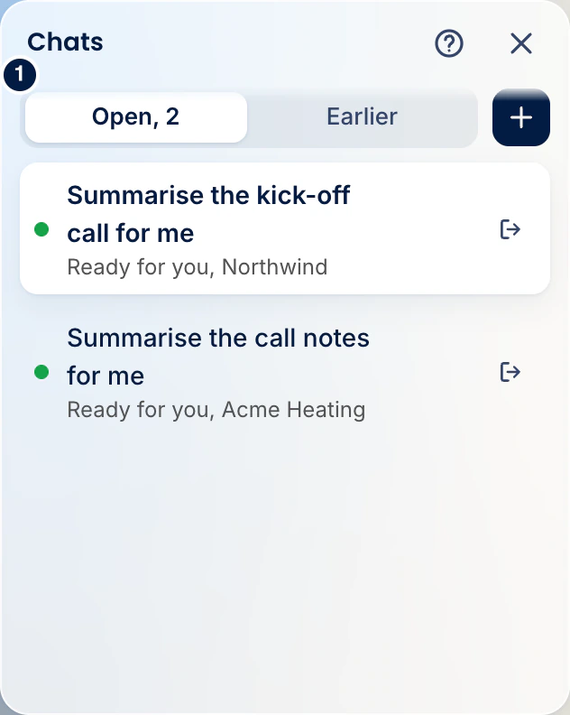

## What it does

The Chats drawer lists every chat you have with Claude. It keeps the ones you're using now apart from the ones you finished earlier.

## Why it helps

- You can run a few jobs side by side and jump between them.
- An old chat is easy to find, so you don't repeat yourself.
- You can tidy away chats you no longer need.

## How to use it

1. Open the Chats drawer from the rail.
2. Use the switch at the top (1). **Open** shows the chats you're using now. **Earlier** shows past ones.
3. Click any chat to carry on with it. To start a new one, press the **+** button at the end of the switch row.
4. In **Earlier**, chats are grouped by when you last used them. Pinned chats sit at the top.

Once you have a personal chat, a second switch appears. It filters by **All**, **TDS** or **Personal**.

## Good to know

- Each chat shows its client and project under its title, such as Acme Heating · Site rebuild. The list isn't narrowed by **Working on** yet, so every chat is always shown.
- You can have up to four chats open at once. If you start a fifth, the one you left longest is closed. If all four are busy, wait or end one.
- A chat you haven't used for 30 minutes goes to sleep, and so does every open chat when the app updates. Send a message in it as usual: it wakes up where you left off, with your message, and goes back under **Open**.
- To end an open chat, press the **End chat** button on its row. You can only delete a chat once it has ended.
- Deleting an earlier chat moves it to the Bin on your Mac. You can put it back from there.
- If Claude hands parts of a job to helpers, they're listed under that chat.

## Try this

Open **Earlier**, find a chat from last week, and click it to carry on.
