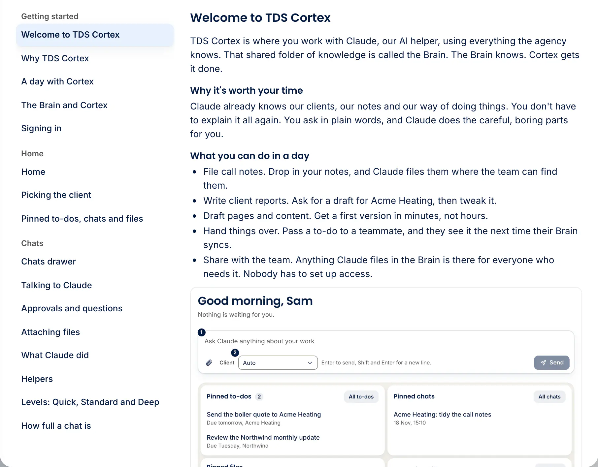

## What it does

The Cortex Guide shows every help page in order, like a book. Contents sit on the left. The page you're reading sits on the right.

## Why it helps

- New starters can read it from the start.
- You can see everything Cortex does in one place.
- You can print the whole guide.

## How to use it

1. Open it from the Help drawer. Press **Open the Cortex Guide**.
2. Or press **⌘K**, then choose **Cortex Guide**.
3. Or go to Settings, open the **About** tab and press **Read the Cortex Guide**.
4. Pick a page in the contents. On a narrow screen the contents become a picker above the page.
5. Follow a link under "Related" to go to another page.
6. Press **Print the guide** to print every page.

## Good to know

- The guide starts with Welcome, Why Cortex and A day with Cortex. Then it goes area by area: Home, Chats, Tasks and so on.
- Printing starts each page on a new sheet and keeps the pictures.
- The rail, the contents and the top bar don't print.
- Everyone who uses Cortex can open and print it.

## Try this

Open the guide and read [A day with Cortex](help:a-day-with-cortex) from the contents.
