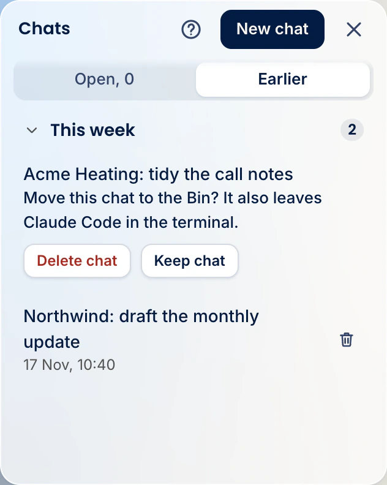

## What it does

You can delete a chat from your list of earlier chats. It moves to the Bin on your Mac, so it isn't gone for good.

## Why it helps

- Your list stays short and easy to scan.
- A mistake is easy to undo: press **Undo** straight away, or put the chat back from the Bin later.

## How to use it

1. Open the [Chats drawer](help:chats-drawer) and choose **Earlier**.
2. Find the chat and press the bin button on its row.
3. The row changes to say the chat has moved to the Bin, with an **Undo** button in its place. Press **Undo** within 10 seconds to keep the chat.

The 10 seconds stop while your pointer or keyboard is on the line, so you have time to reach **Undo**.

## Good to know

- You can only delete an earlier chat. End an open chat first.
- The chat also leaves Claude Code in the terminal. If you use the terminal, check before you delete.
- To get a chat back, open the Bin on your Mac and put it back.
- If you close Cortex before the 10 seconds are up, the chat still moves to the Bin.
- Nothing is deleted if the move fails. The chat stays in your list, and Cortex shows what went wrong.

## Try this

Find an old test chat in **Earlier**, and move it to the Bin.
