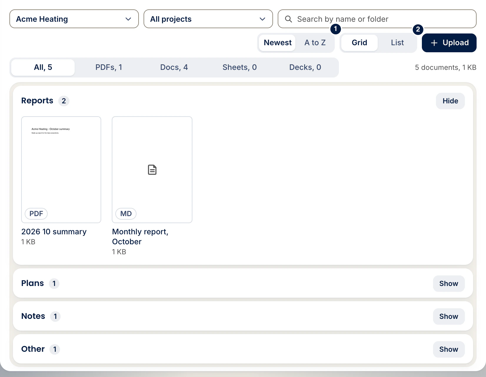

## What it does

Documents shows the files in the Brain that you're allowed to see. You can browse them by client and open them to read.

## Why it helps

- You find the latest version without asking around.
- You can read a file without opening another app.
- You can send a file straight into a chat.

## How to use it

1. Open Documents from the rail.
2. Pick a client, or search by name.
3. Use **Layout** (1) to switch between **Grid** and **List**.
4. Use **Type** to show only PDFs, docs, sheets or decks. Use **Sort** to put the newest first, or A to Z.
5. Open a file to preview it. You can also download any file.

## Good to know

- You only see what your role lets you see.
- PDFs, text, Markdown and web pages open inside the app.
- Very large libraries may not list every file.
- Click a file, then press **Ask Claude about it** in the panel to talk about it with Claude. See [Talking to Claude](help:talking-to-claude).

## Try this

Pick Acme Heating, set **Sort** to newest, and open the first file.
