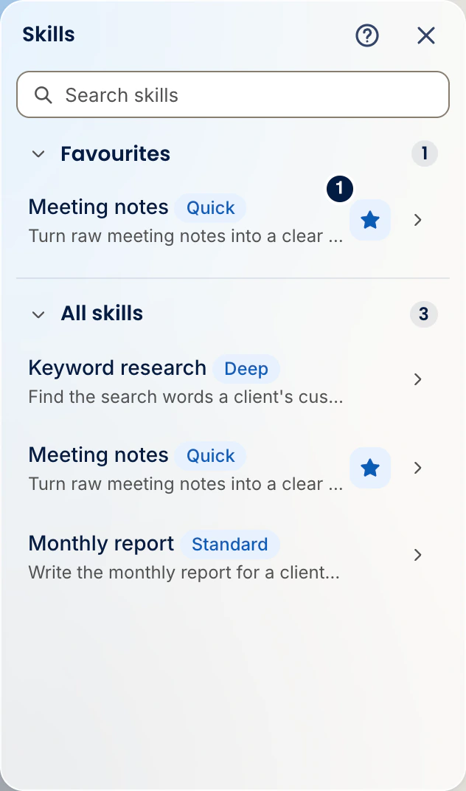

## What it does

A pin keeps something at the top. A pinned chat, task or skill goes into a **Pinned** section at the top of its list. A pinned file shows on Home under **Pinned files**. Pinned tasks and chats also appear on Home. See [Pinned tasks, chats and files](help:pinned).

## Why it helps

- The things you use daily are always at the top.
- You stop scrolling past everything else.
- One click on the pin is all it takes.

## How to use it

1. Find a chat, task, skill or file. Chats, tasks and skills have a pin at the end of their row in their drawer.
2. Press the pin button. Its tooltip says **Pin**.
3. A chat, task or skill moves up into **Pinned**. A file shows on Home.
4. Press the pin again to take it off.

For a file, open it in the viewer. The pin sits beside the **Download** button. See [Viewing a file](help:viewing-a-file).

## Good to know

- Pins are yours alone. They are kept in Cortex on your computer, so teammates don't see them.
- Starring a task doesn't change the task. It works even when **Let the app change tasks** is off.
- Pinned skills show on Home under **Pinned skills**.

## Try this

Open the Skills drawer and pin the skill you use most.
