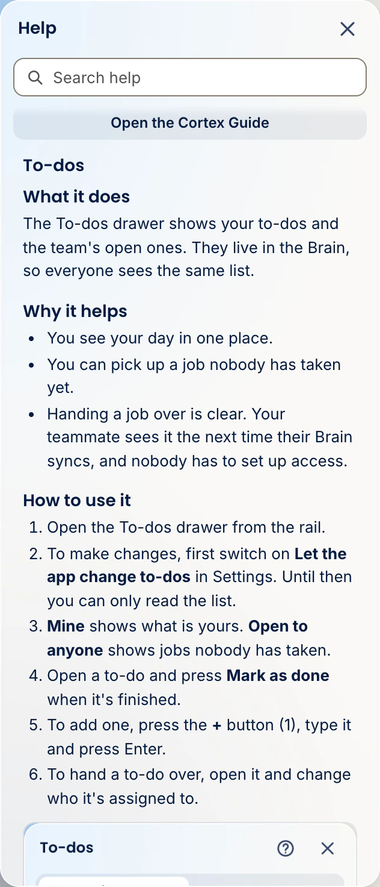

## What it does

The Help drawer opens on the help page for the screen you're on. It also lets you search every help page.

## Why it helps

- You get the right answer without leaving your work.
- You can search in your own words.
- Closing it puts you back where you were.

## How to use it

1. Press **Help** on the rail. Or press H or ?, when you aren't typing.
2. Read the page that opens. If you're in the To-dos drawer, you get the to-dos page.
3. Type in **Search help** to find another page.
4. Open an area to see its pages, and click one to read it.
5. Press **Back** to return to the page before.
6. Press **Open the Cortex Guide** to read everything as a book. See [The Cortex Guide](help:cortex-guide).
7. Press Esc to close Help.

## Good to know

- Help is there for everyone who uses Cortex.
- Some screens have a small "?" button beside a heading. It opens Help on the right page.
- Closing Help brings back the drawer it replaced.
- Help is part of the app, so it doesn't need the Brain to load.
- The H and ? keys need **Single-key shortcuts** switched on in Settings.

## Try this

Open To-dos, then press **Help** on the rail to see the to-dos page open.
