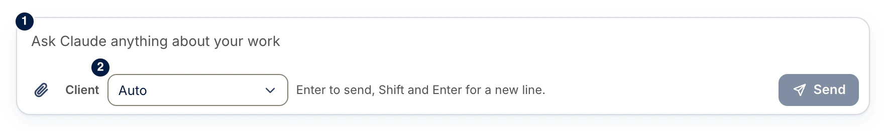

## What it does

Home is the first screen you see in TDS Cortex. It has a message box for starting a chat, and cards for the things you use most.

## Why it helps

- You can start work straight away, without hunting for the right place.
- Claude uses the right client's notes, so answers fit the job.
- Your pinned to-dos, chats and files are one click away.

## How to use it

1. Click the message box (1). It says "Ask Claude anything about your work".
2. Type what you need, in plain words.
3. Leave the client picker (2) on **Auto**. Cortex then works out which client you mean. If it isn't sure, it asks you.
4. Or pick a client yourself. Choose **No client** if the job isn't about one.
5. Press **Send**.

Under the box you will see your pinned to-dos, pinned chats and pinned files. If you have no favourite skills yet, Home shows the ones you use most. A skill is a saved set of steps Claude follows. See [Skills](help:skills).

## Good to know

- Your chat opens as soon as you send, and you can follow it in the [Chats drawer](help:chats-drawer).
- Pick a skill first, and Home starts the chat from that skill.
- After an update, a What's new card may show above the message box. It says what changed and links to Help. Press **Close** to hide it. See [Updates and what's new](help:updates).

## Try this

Type "What's overdue for Acme Heating?" in the box, and press **Send**.
