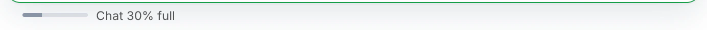

## What it does

Claude can only hold so much in mind at once. The meter under the message box shows how full a chat is, in words such as "Chat 40% full".

## Why it helps

- You can see a long chat getting heavy before it slows down.
- You can choose when to start a new chat, rather than be surprised.

## How to use it

1. Send a message. The meter shows once Claude has replied.
2. Watch the bar. It turns amber at 60% and red at 85%.
3. When it's red, think about starting a new chat for your next job.
4. For more detail, open the [This chat panel](help:this-chat-panel). On the **Details** tab, open the **Context** fold.

The **Context** fold lists what takes up the most room. Claude counts in tokens, which are small chunks of text.

## Good to know

- When a chat is nearly full, Claude can summarise the earlier messages. The meter then says so. Claude keeps the gist, not every word.
- The first reading can be rough. If the fold says so, open it again after a minute for the full list.
- The meter is hidden until Claude's first reply.
- Colour is never the only signal. The words say it too.

## Try this

In a long chat, open the **Context** fold and see which item takes the most room.
