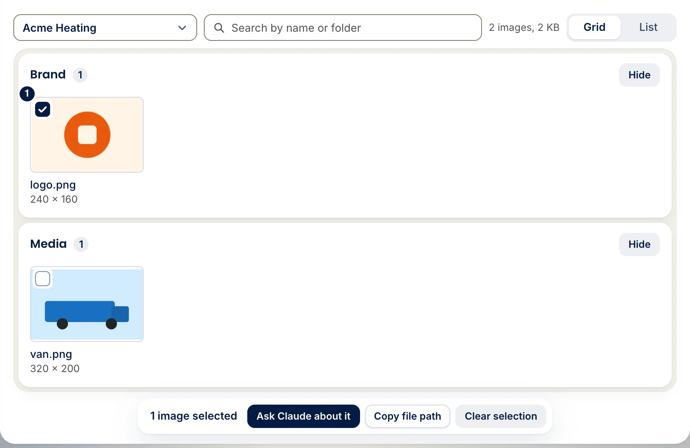

## What it does

Images shows the pictures in the Brain that you're allowed to see. You can browse by client, in a grid or a list.

## Why it helps

- You find the right logo or photo without asking around.
- You see a preview before you use it.
- You can hand a picture to Claude in one click.

## How to use it

1. Open Images from the rail.
2. Pick a client, or search by name.
3. Use **Layout** to switch between **Grid** and **List**.
4. Tick a picture (1) to select it.
5. Press **Ask Claude about them** to start a chat about your pictures.
6. Press **Copy file paths** to copy where they are kept. A file path is a file's address.

## Good to know

- You only see what your role lets you see.
- You can download any picture.
- Very large libraries may not list every file.
- To delete a picture, point at it and press its bin. It's kept for 30 days. See [Deleting files](help:deleting-files).
- The buttons in steps 5 and 6 appear once you tick a picture. With one picture ticked, they say **Ask Claude about it** and **Copy file path**.

## Try this

Tick two of Northwind's pictures, and press **Ask Claude about them**. Then type "Which is better for a banner?"
