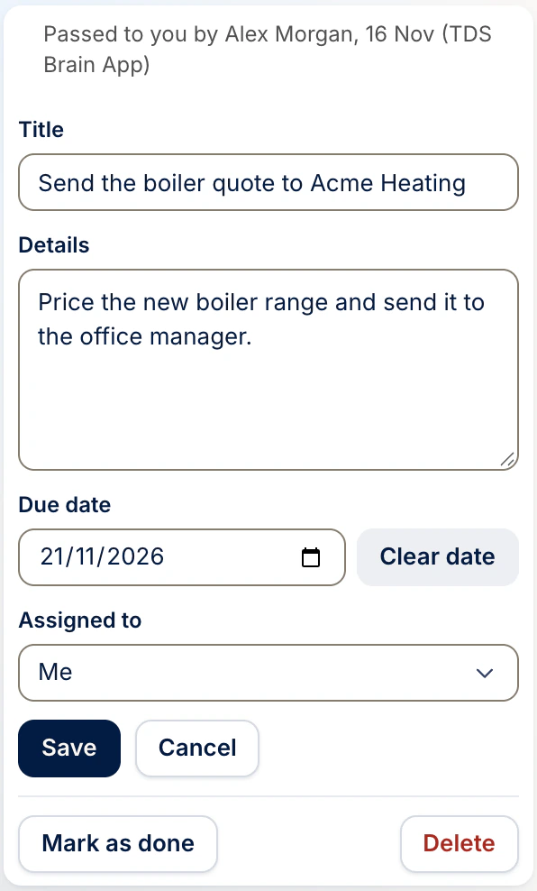

## What it does

You can give a task to a teammate, or make it **Open to anyone** so the first free person can take it.

## Why it helps

- The job lands on the right person's list.
- Nothing needs setting up. Your teammate sees it because the task lives in the Brain, the team's shared folder.
- They see who passed it on and when.

## How to use it

1. Switch on **Let the app change tasks** in Settings (**General** tab), if it is off.
2. Press the task's title in the Tasks drawer, then press **Edit** in the panel.
3. Pick a name in the **Assigned to** box. Pick **Open to anyone** to leave it for the team.
4. Add a note for your teammate if you like. It is saved in the task's updates.
5. Press **Save**. The task leaves your list for a few seconds, with **Undo** showing. Then it is sent.

## Good to know

- Your teammate sees the change the next time their Brain syncs. That is not always straight away.
- A teammate who gets the task sees a line such as "Passed to you by" your name, with the date.
- Passing a personal task on makes it a TDS task, so your teammate can see it.
- To follow a task after you've passed it on, open the **Asked** tab. See Asked of others.
- To take an open job yourself, open it and choose **Me** in **Assigned to**.
- To return a task to the person who gave it to you, press **Hand back to** and their name. See Updates and handing back.

## Try this

Open a task that someone else should do, choose their name in **Assigned to** and press **Save**.
