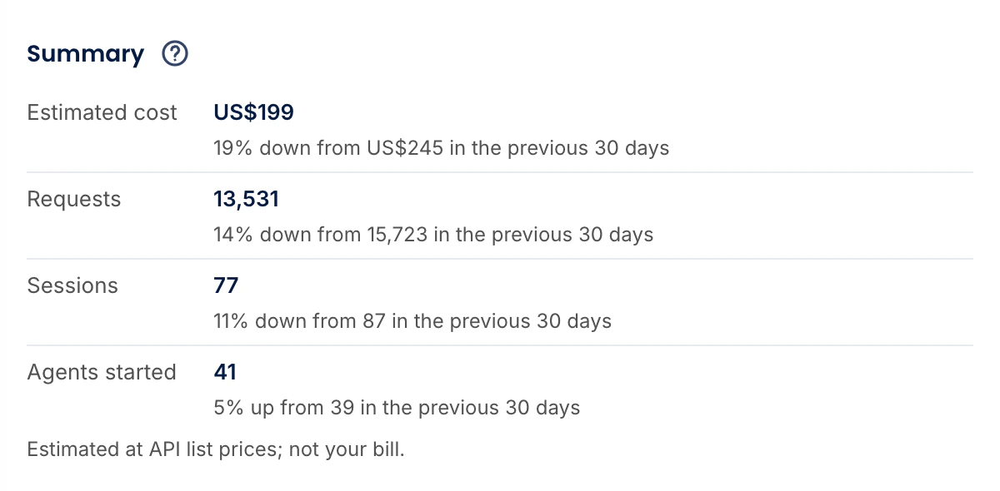

## What it does

Only owners and scouts see this tab. It shows how Claude Code has been used on this Mac. That covers your code folders, the Brain and chats in this app. It shows how much was used and where. It never shows what was said.

## Why it helps

- You see which projects and models use the most.
- You can check whether Code Mode makes sessions cheaper.
- Figures build up day by day, so you can judge a change after a few weeks.

## How to use it

1. Open Settings from the rail, then the **Performance** tab.
2. The first time, it builds the first report. This takes a few seconds.
3. Pick **Last 7 days**, **30 days** or **90 days**.
4. Read **Summary**, then **Daily** (**Weekly** for 90 days), then **Where it goes**. Each table sorts when you press a heading.
5. Look at **Code Mode** to compare sessions with it on and off.
6. Press **Update now** to refresh the figures straight away.

## Good to know

- The page updates once a day by itself.
- Costs are estimates at the published list prices. They are not your bill.
- Requests on a model with no known price are left out of the cost. The page says how many.
- **Code Mode** gives no verdict until both sides have at least 20 sessions.
- Only this Mac is counted. There is no team total yet.
- Figures are kept even after Claude Code clears its own old logs.
