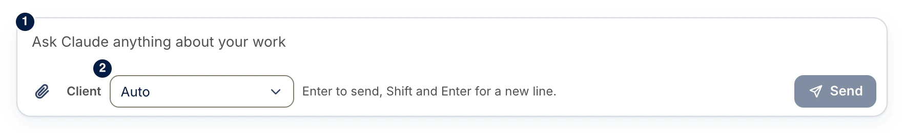

## What it does

Each new chat can be about one client. The **Client** picker, inside the message box on Home, tells Claude which one. Claude then reads that client's notes.

## Why it helps

- Answers use the right client's facts.
- Filed notes and files go to the right place.
- You don't have to name the client in every message.

## How to use it

1. Click the **Client** picker on Home.
2. Leave it on **Auto** to let Cortex guess from your first message.
3. Or pick a client by name. You can type to search the list.
4. Choose **No client** if the job isn't about one.
5. Type your message and press **Send**.

If Cortex isn't sure, it asks **Which client is this for?** Pick a name, pick **No client**, or press **Cancel** to change your message.

## Good to know

- Auto only works on the first message of a new chat. Cortex first looks for a client's name in your message. If it can't tell, it sends that message and the client list to Jev, a TypeSafe service, to work it out.
- If you pick a client or **No client** yourself, nothing is sent to Jev.
- The picker remembers the clients you used recently.
- You can read this note in Settings, on the **General** tab, under **Working out the client**.

## Try this

Type "What did we agree with Northwind last time?" with the picker on **Auto**, and see which client Cortex picks.
