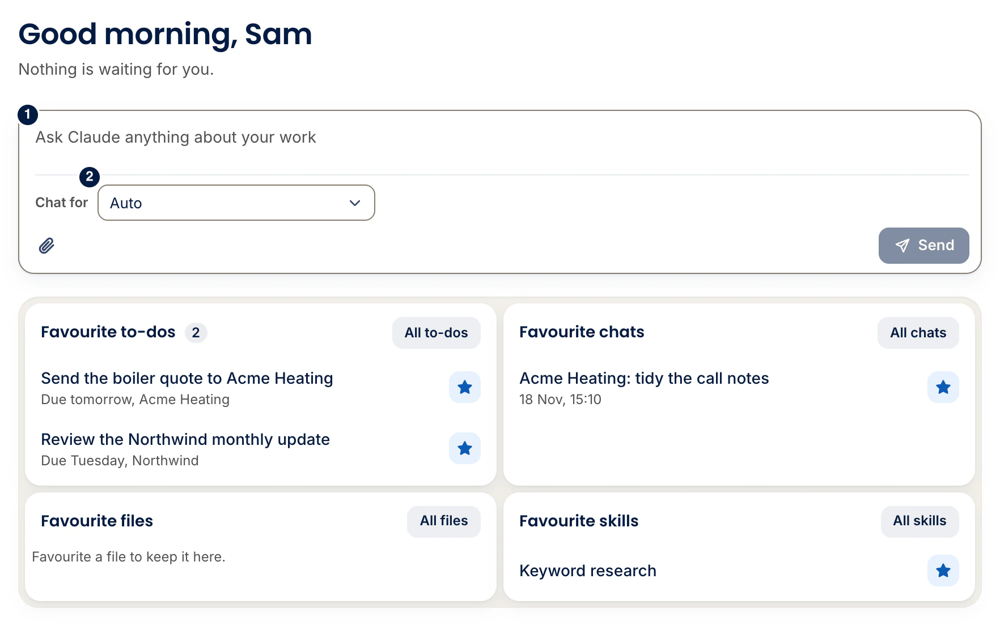

## What it does

Under the message box, Home shows cards for the things you have pinned. You pin a task, a chat or a file with the pin button.

## Why it helps

- Your most important jobs are in front of you each morning.
- You jump straight back into a chat you're still using.
- A file you check often opens in one click.

## How to use it

1. Pin a task, a chat or a file. See [Pinned](help:favourites) for where the pin sits.
2. Go to Home.
3. Look at the cards **Pinned tasks**, **Pinned chats** and **Pinned files**.
4. Click a row to open it. A task opens in the task panel, where **Start a chat** or **Open chat** takes you to its chat. A file opens in the viewer.
5. Press **All tasks**, **All chats** or **All files** to see the full lists.

## Good to know

- Each card shows five rows. If you have more, a button at the bottom says how many (such as "Show 2 more tasks"). Press it to show them all in the card. Press **Show fewer** to fold it back.
- Each row has its own pin. Unpin it, on Home or anywhere else, and the item leaves Home at once.
- Pins are yours alone. They are kept in Cortex on your computer, so teammates don't see them.
- With nothing pinned, each card says "Pin a task to keep it here" and so on.
- The skills card shows **Pinned skills**. With none pinned, it shows **Used often**.

## Try this

Open the Tasks drawer, pin the job you most need to finish today, then go to Home and click it.
