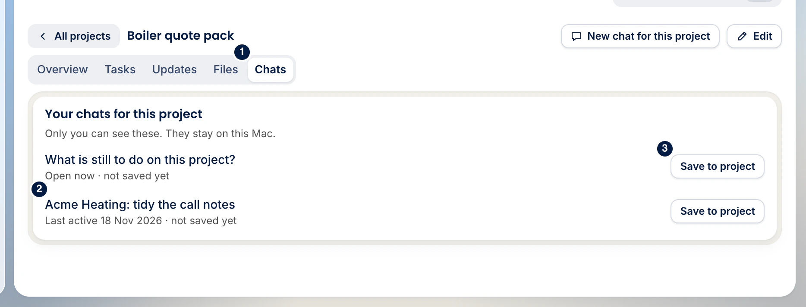

## What it does

Every project has a **Chats** tab. It lists each chat you had for that project on this Mac, newest first. Each row says when you last used the chat, and whether you saved it to the project.

## Why it helps

- You find a project's chat without searching the Chats drawer.
- You carry on where you left it, with the project still in view.
- You see which chats the team has no summary of yet.

## How to use it

1. Open a project and press **Chats** (1).
2. Press a chat's name (2). It opens beside the project, ready for your next message.
3. Read the line under the name. It says when you last used the chat and whether it is saved.
4. Press **Save to project** (3) to share a summary with the team. Claude drafts it, and you check it first.

## Good to know

- Only you can see these chats. They stay on this Mac.
- Teammates see their own chats here, not yours. They read your summaries under **Updates**.
- A chat is listed when you started it from the project, or chose the project in the message box.
- "New messages since you saved" means the chat has moved on. Save it again to add what is new.
- A saved chat with nothing new has no **Save to project** button. Nor has a chat that is still replying.
- The tab shows your newest 100 chats. Older ones are in the Chats drawer.
- To delete or star a chat, use the Chats drawer.

## Try this

Open a project you chatted about this week, press **Chats** and open the top chat.
