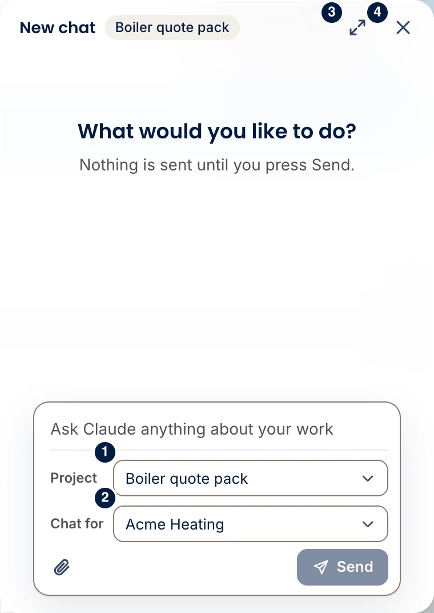
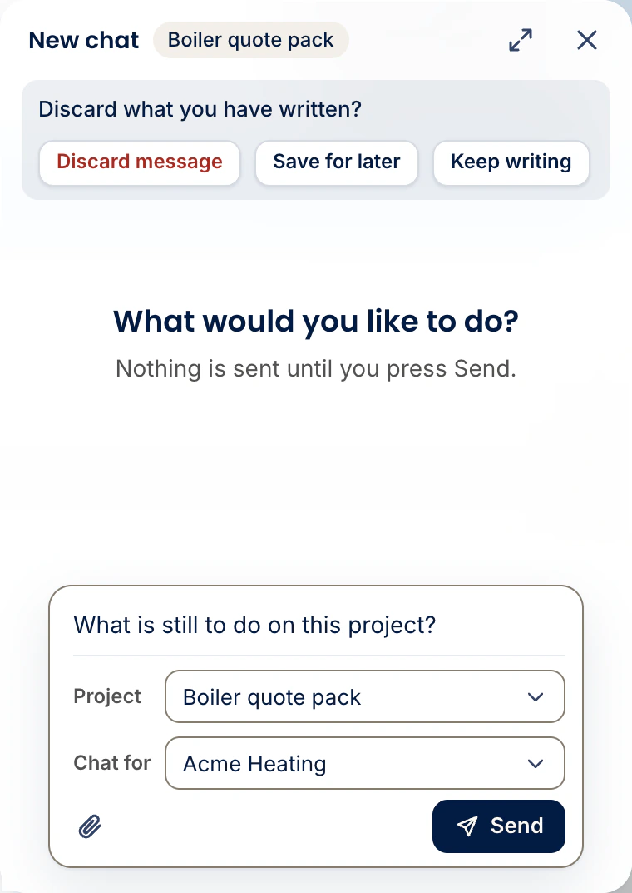

## What it does

A chat you start from a project opens beside the project's page. You stay in the project. The message box is already set to that project and its client, and the chat stays beside the page after you send.

## Why it helps

- You keep the brief, tasks and files in view while you talk to Claude.
- You don't pick the project or the client again.
- Files Claude makes in the chat are saved to the project.

## How to use it

1. Open a project and press **New chat for this project**.
2. Check **Project** (1) and **Chat for** (2). Both are filled in for you.
3. Type your message and press **Send**. The reply appears above, in the same place.
4. Press **Open full screen** (3) for more room. Your message and both pickers go with you.
5. Press **Hide chat** (4) to close it. A chat you have sent keeps running, and Chats lists it.

On the project's **Tasks** tab, a task's chat button opens its chat the same way.

To finish a message later, leave the chat. When Cortex asks about your text, press **Save for later**. The button you started from changes its name to **Open saved message**. Press it and your message is back.

## Good to know

- Nothing is sent until you press **Send**.
- Leave with text typed and Cortex asks first. **Keep writing** stays. **Discard message** throws the text away.
- A saved message keeps its project and client. It stays until you send it, discard it or clear the box.
- It is kept in this browser, for you only. Attached files can't be saved.
- On a task's chat button, point at it to see **Open saved message**.
- Changing tab inside the project keeps the chat and your text.
- Pick another client in **Chat for** and **Project** changes to **No project**. The chat is then not for the project.
- On a narrow window the chat sits over the page, not beside it.
- A project's chat doesn't change **Working on** on Home.

## Try this

Open a project, press **New chat for this project** and type "What is still to do on this project?"
