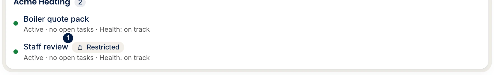

## What it does

A restricted project is hidden in Cortex. Only its Account Owner, its team, and the agency's owners and scouts can see it. Everyone else sees no trace of it: not in lists, search or pickers.

## Why it helps

- Pay reviews, a sale or a tricky client stay private to the people involved.
- Owners and scouts can still see what exists. They see a "Restricted" mark beside the title.

## How to use it

1. Open the project and press **Edit**, or press **New project**.
2. Find **Who can see it**. Choose **Only the project team**, or **Everyone on the team** to open it up again.
3. Save. Cortex asks you to confirm before it hides a project that already exists.

Anyone can choose this when they make a new project. After that, only the project's Account Owner, an owner or a scout can change it, and nobody else sees the choice. Personal projects don't have it: they are already yours alone.

## Good to know

- A task in a restricted project can only go to someone who can see it. If not, Cortex tells you to add them to the project team first. See [passing a task on](help:passing-todos-on).
- A task you already hold in a project you can't see stays yours. It shows "Restricted project" in place of the name.
- Its meeting notes, and files added on its **Files** tab, are hidden with it. A file that a project you can see also uses stays visible.
- Adding an existing client file to a restricted project hides that file from people outside it, until a project they can see also uses it.
- **What it does not do:** this hides a project in Cortex. It is not a lock.
- The project's files are still in the Brain on every team Mac, so they can be opened outside Cortex.
- Someone on an older Cortex still sees the project until they update.
- The chat assistant won't open a hidden project's folder when asked. A broad search, or a skill run in a chat, can still turn up a line from it.
- Making a project with the same name says the name is taken.

## Try this

Make a test project with only you on it, and choose **Only the project team**.
