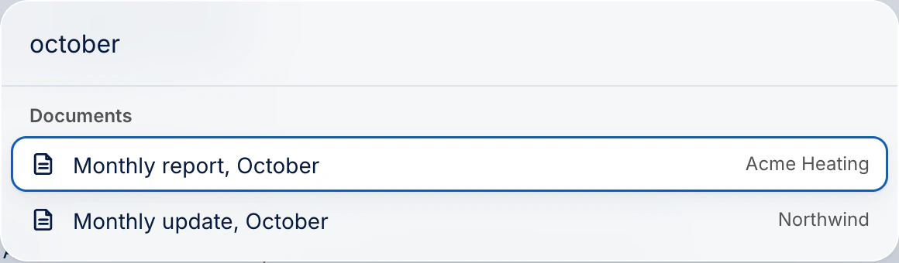

## What it does

**Search or jump to** is one box that finds things across Cortex. It also takes you to any screen.

## Why it helps

- You find a task, chat or file by typing a few letters.
- You reach a drawer or an app without reaching for the mouse.
- It works from every screen.

## How to use it

1. Press **⌘K** on a Mac, or **Ctrl K** on Windows. You can also press the **Search or jump to** button at the top. When you aren't typing, the slash key (/) works too.
2. Type a few letters. Results are grouped: Go to, Tasks, Open chats, Skills, Clients, Projects, Earlier chats and Help. Files from Documents and Images show too.
3. Use the up and down arrow keys to move through the results.
4. Press Enter to open the one you want. Press Esc to close the box without choosing.

## Good to know

- With nothing typed, the box shows places to go and a few of your own tasks and chats, and your pinned skills.
- Each group shows its best six matches.
- Picking a client starts a new chat for that client. Each project shows two rows. **Open project** opens it. **Filter to this project** sets **Working on** to it on Home. You can find a project by its code too.
- Picking a skill starts a chat with that skill.
- **Help** is here too, and help pages show in the results.
- The slash key needs **Single-key shortcuts** switched on in Settings (**General** tab). **⌘K** works everywhere except an open file. Press Esc to close the file first.

## Try this

Press **⌘K**, type "Acme", and see which tasks, chats and files match.
