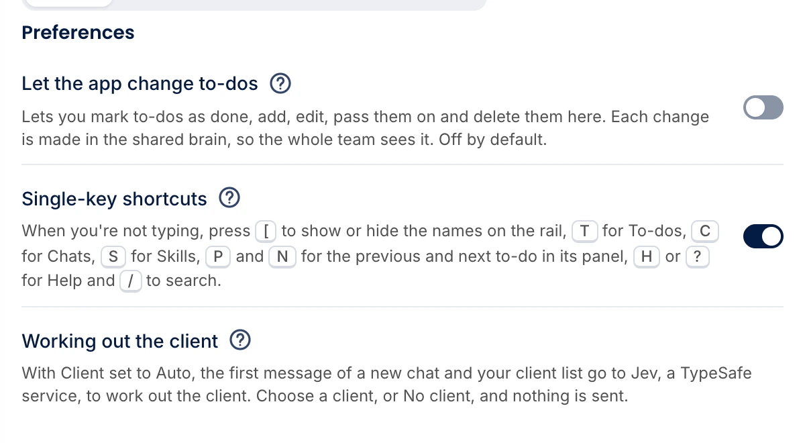

## What it does

Settings is one page with your choices and a check on how Cortex is running. It opens from the rail.

## Why it helps

- You can turn features on or off without asking anyone.
- A quick look tells you if something is wrong.
- Owners and scouts can see what changed in each version.

## How to use it

1. Open Settings from the rail.
2. At the top, read **How TDS Brain is running**. It says if everything works.
3. Under **Preferences**, switch **Let the app change to-dos** and **Single-key shortcuts** on or off.
4. Under **Claude in chats**, choose how Claude picks a level for each chat.
5. Under **Skill levels**, see the level the team set for each skill.
6. Under **Tokens saved**, see how much shorter chats became.
7. Under **About TDS Brain on this computer**, see who you are, the version and the Dock app.

## Good to know

- Each part has its own help page. See Related below.
- Your choices are kept on this Mac, not shared with the team.
- **What's changed** shows only for owners and scouts.

## Try this

Open Settings and read the line under **How TDS Brain is running**. It should say everything is working.
