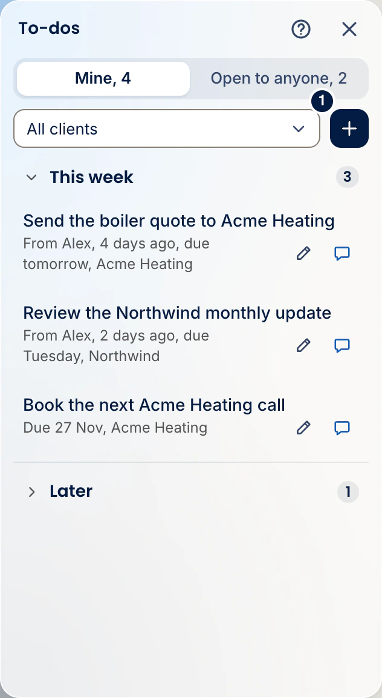

## What it does

Anything you save to the Brain is shared with the team. That covers a task you pass on, a note Claude files and a file you add. Your teammates see it the next time their Brain syncs.

## Why it helps

- Passing a task is very visible. Your teammate sees a dot and "New to you" in their list.
- Nobody sets up access. Being on the team gives it.
- Everyone works from the same facts, so there is less chasing.

## How to use it

1. Open the Tasks drawer from the rail.
2. Open a task, and change who it is assigned to.
3. Save it. The change goes into the Brain.
4. Check the foot of the rail. **Synced** shows when your Brain last synced.

To file a note, ask Claude in a chat, such as "File these call notes under Northwind." Claude tells you where it put them.

## Good to know

- A sync is when your computer's copy of the Brain catches up with the shared one. It happens on its own.
- If the stamp turns red, your Brain hasn't synced for over five minutes. Check you're online.
- To change tasks here, switch on **Let the app change tasks** in Settings (**General** tab) first.
- Personal tasks stay private. Passing one on makes it a TDS task, so your teammate can see it.
- Stars and pins are not shared. They stay on your computer.

## Try this

Pass one small task to a teammate today, then ask them whether they saw the dot.
