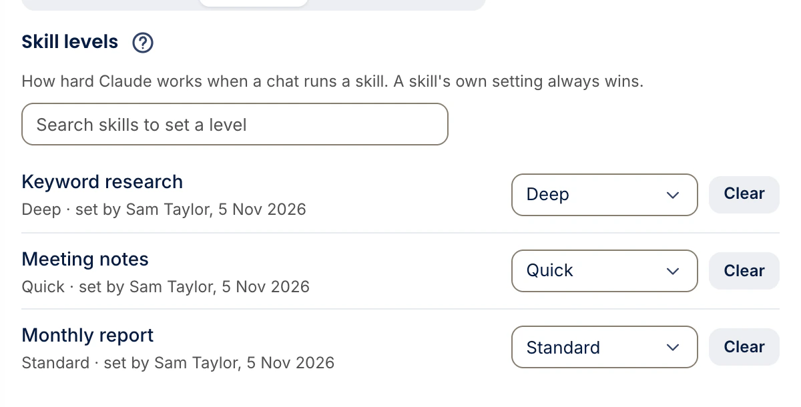

## What it does

Only owners and scouts can change this. Ask one if you need it. Each skill can have a team level: **Quick**, **Standard** or **Deep**. It says how hard Claude works when a chat runs that skill.

## Why it helps

- Look-ups stay fast and cheap.
- Audits and strategy get careful thought.
- The whole team gets the same level, so results are steady.

## How to use it

1. Open Settings from the rail, then the **Skill levels** tab. The tab shows only when your Brain has skill levels.
2. Each row shows a skill, its level and who set it.
3. To change one, pick a level in the box on its row.
4. To add a level for a skill with none, type its name in **Search skills to set a level**. Then pick a level.
5. To remove a level, press **Clear**.

## Good to know

- **Quick** is for look-ups and short answers. **Standard** is for most writing and reports. **Deep** is for audits and careful judgement.
- A skill's own setting always wins over the team level.
- Everyone else can read the list but not change it.
- Changes are saved in the Brain, so teammates see them when their Brain next syncs.

## Try this

Search for a skill that does simple filing and check its level is **Quick**.
