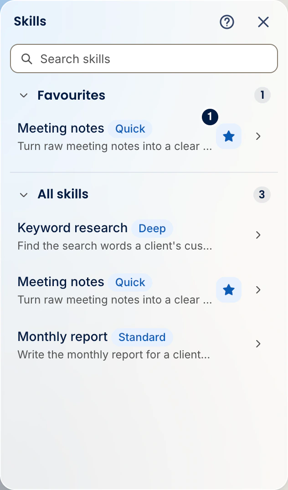

## What it does

A skill is a saved set of steps Claude follows. The Skills drawer lists the ones you can run, such as filing call notes.

## Why it helps

- A job is done the way the agency does it, every time.
- You don't have to remember the right words to type.
- Your pinned skills are always at the top.

## How to use it

1. Open **Skills**, near the bottom of the rail just above **Help**.
2. Type in **Search skills** to find one.
3. Click a skill to start a chat with it.
4. Add anything extra after the skill's name, such as the client.
5. To keep a skill handy, press the pin (1) beside it.

The list has three parts. **Pinned** holds the ones you pinned. **Used often** holds the ones you run most. **All skills** has the full list.

## Good to know

- Only owners and scouts have **Skills** on the rail. Everyone else starts a skill from [Home](help:home) or from **Search or jump to**.
- Your pinned skills also show on [Home](help:home).
- Some skills are only for certain roles. If yours isn't one of them, TDS Cortex will not run the skill.
- Skills belong to the Brain, so the whole team gets the same ones.

## Try this

Search for "notes", pin the skill you find, and use it after your next call.
