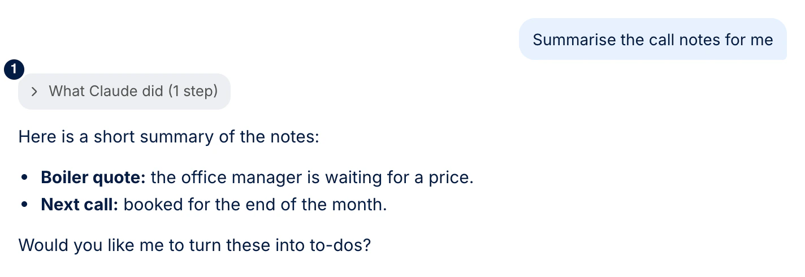

## What it does

A chat is a conversation with Claude. You write what you need, and Claude replies, makes changes and files things for you.

## Why it helps

- You explain the job once, in your own words.
- Claude shows what it did, so you can check it.
- Files you attach are filed in the Brain for you.

## How to use it

1. Type your message in the box at the bottom of the chat.
2. To add files, drop them on the chat, paste a screenshot, or use the paperclip button.
3. Press **Send**. To stop Claude part-way, press **Stop**.
4. Read the reply. Open the **What Claude did** fold (1) to see each step Claude took.

Claude may ask your permission, or ask you a question. See [Approvals and questions](help:approvals-and-questions).

## Good to know

- You can attach up to 10 files, 32 MB each. They can be documents, spreadsheets, slides, text or pictures.
- Claude files each attachment in the Brain and tells you where it went. If the client isn't clear, it asks.
- If a chat has been quiet for a while, a check in Claude Code may hold back your message. Cortex says why and shows **Send again**. Press it to send the same message.
- You can reopen any chat from the [Chats drawer](help:chats-drawer).

## Try this

Paste a screenshot of an email, and type "File this under Northwind, and tell me what's in it."
