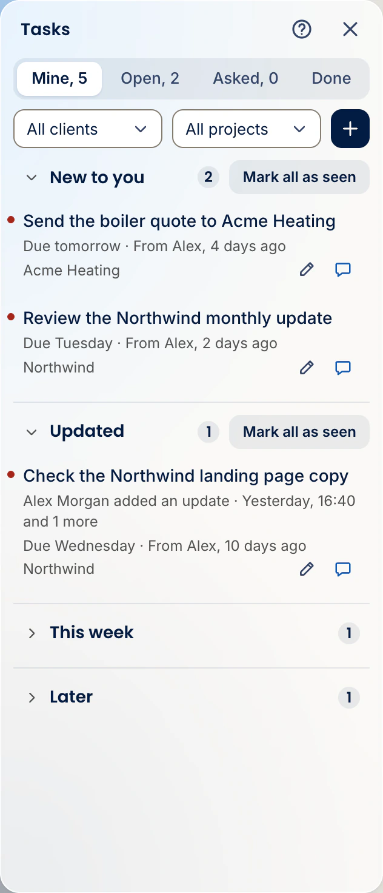

## What it does

Cortex tells you when a teammate does something to a task you care about. That means a task you hold, or one you asked someone else to do. It counts an update, a changed date, a new file or link, a hand back, a pass-on to someone else and a finished task.

## Why it helps

- You see what changed without opening each task.
- A reply to your question doesn't sit unread.
- You know a job you asked for is done as soon as your Brain syncs.

## How to use it

1. Look at **Tasks** on the rail. A red number on its icon counts the tasks that are new to you or have updates.
2. Open the Tasks drawer. **Updated** at the top of **Mine** lists the tasks a teammate has changed.
3. Each one says what happened last, who did it and when.
4. Press **Asked**. A dot on the tab means a task you asked someone to do has updates. They are under **Updated** there too.
5. Press a task to open it. What you haven't seen is marked **New** in its **Updates** list.
6. Opening a task counts as seeing it. To clear them all, press **Mark all as seen**.
7. On Home, the **Task updates** card shows the same tasks.

## Good to know

- Your own changes never count. Nor do personal tasks, because only you can change them.
- A task that has just been given to you is under **New to you**, as before.
- If someone passes on a task you asked them to do, it stays in **Asked** under the new person's name, and you are told.
- A change shows for seven days, then it stops counting as new.
- You hear about a change when your Brain syncs. That is not always straight away.
- These notices are only in Cortex. Your Mac doesn't show a banner.
- You can hide the **Task updates** card in **Customise Home**.

## Try this

Ask a teammate to add an update to a task you gave them, then watch for the red number on **Tasks**.
