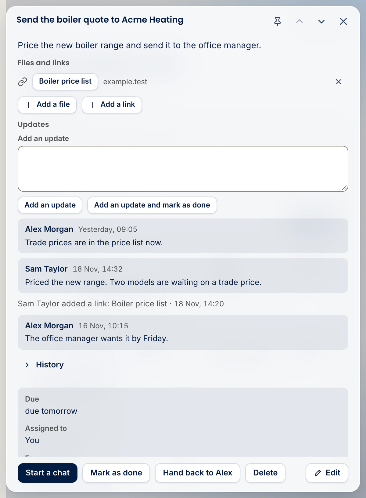

## What it does

Every task has an **Updates** list. It shows what happened to the task, newest first, with the person, the date and the time. You can add an update of your own. If a teammate gave you the task, you can hand it back with a note.

## Why it helps

- You can say what you did without rewriting the details.
- The person who asked can answer a question without taking the task back.
- Nobody has to ask "did that get done, and when?".

## How to use it

1. Open a task. **Updates** is under its files.
2. Type in **Add an update**, then press **Add update**. A web address in your update becomes a link.
3. When the job is finished, press **Add update and mark as done**. Your update is saved and the task is ticked off.
4. To return a task to the person who gave it to you, press **Hand back**. Add a note if you like, then press **Hand back** again.
5. To pass a task to someone else, press **Edit** and change **Assigned to**. You can add a note for them.
6. On a task you passed on, open it from the **Asked** tab and add an update there.

## Good to know

- Cortex adds a line by itself when the due date, the details, a file or a link changes.
- An update can't be changed or removed once it is saved.
- Your teammate sees an update the next time their Brain syncs. That is not always straight away.
- A task that was handed back to you has no **Hand back** button. Pass it on from **Edit** as usual.
- Personal tasks have updates too. Only you see them, unless you move the task to TDS.
- This needs the newest version of the brain's `todo` skill. Until then the list shows, but the boxes don't.

## Try this

Open a task a teammate gave you, write one line about where it stands and press **Add update**.
