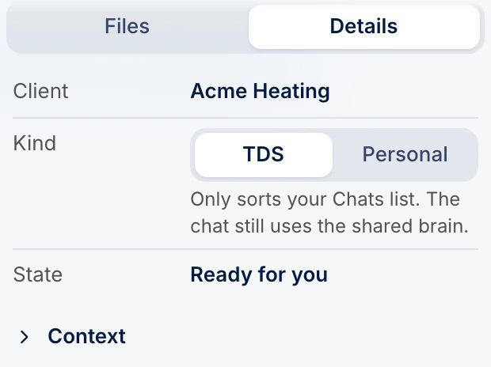

## What it does

The **This chat** panel sits beside an open chat. It has two tabs: **Files** and **Details**.

## Why it helps

- Everything a chat touched is in one place.
- You can check the client, the state and the settings at a glance.

## How to use it

1. Open a chat.
2. Press the panel button at the top right of the chat. Its name is **This chat**.
3. Choose **Files** or **Details**.

**Details** shows these lines:

- **Client**: the client this chat is about.
- **Kind**: TDS or Personal, for open chats. See [TDS or Personal chats](help:chat-kinds).
- **To-do**: the to-do the chat started from, if any.
- **Started**: when it began.
- **State**: for example Working, Ready for you, Needs your answer or Ended.
- **Approvals**: **Same as your terminal**. Cortex asks as often as your terminal does.

The picture leaves out Started and Approvals. Owners and scouts also see **Continue in the terminal**. See [Continuing in the terminal](help:continuing-in-the-terminal).

## Good to know

- The panel only shows for a chat that is open.
- The **Context** fold on this tab shows [how full the chat is](help:how-full-a-chat-is).
- The **Files** tab is explained in [Chat files](help:chat-files).
- To share what a chat achieved, see [Saving a chat to a project](help:saving-chats-to-projects).

## Try this

Open **Details** during a long chat and check the **State** line.
