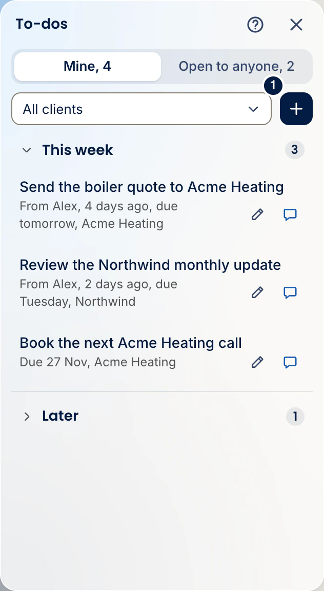

## What it does

The To-dos drawer shows your to-dos and the team's open ones. They live in the Brain, so everyone sees the same list.

## Why it helps

- You see your day in one place.
- You can pick up a job nobody has taken yet.
- Handing a job over is clear. Your teammate sees it the next time their Brain syncs, and nobody has to set up access.

## How to use it

1. Open the To-dos drawer from the rail.
2. To make changes, first switch on **Let the app change to-dos** in Settings (**General** tab). Until then you can only read the list.
3. **Mine** shows what is yours. **Open** shows jobs nobody has taken. **Asked** shows what you passed on to others (see Asked of others).
4. Pick a project in the **Project** filter to see only its to-dos, on any tab. A to-do in a project shows its name. Press the name to filter by it. **Working on** on Home sets this filter too.
5. Press a to-do's title to read it in a wide panel. Press **Mark as done** when it's finished.
6. To add one, press the **+** button (1), type it and press Enter.
7. To hand a to-do over, open it, press **Edit** and change who it's assigned to.
8. Press **Done** to see finished to-dos, newest first. You can search them and read them, but not change them.

## Good to know

- TDS Cortex can't change to-dos until that switch is on. It's off by default, because to-dos are shared by the whole team.
- Passing a personal to-do on makes it a TDS to-do, so your teammate can see it.
- Marking something done records who did it and when.
- **Done** shows the whole team's finished to-dos, plus your own personal ones. A project's **To-dos** tab keeps its finished ones in a folded **Done** section. Search finds them too, marked as done.
- Open a to-do's **History** (at the bottom of the panel) to see how it changed.

## Try this

Press **Open** and pick one job you can take today.
