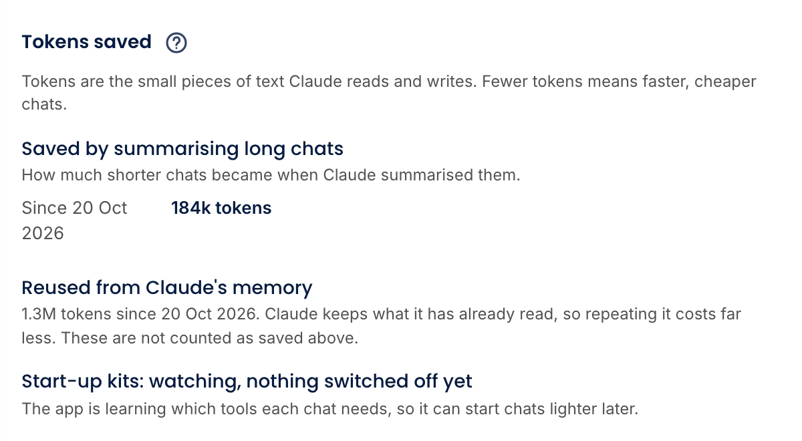

## What it does

Tokens are the small pieces of text Claude reads and writes. When a chat gets long, Claude can summarise the early part. **Tokens saved** shows how much that cut.

## Why it helps

- Fewer tokens means faster, cheaper chats.
- You see the effect of summarising, in numbers.
- The figure comes from this Mac's own count, not from a guess.

## How to use it

1. Open Settings from the rail, then the **Claude** tab.
2. Scroll down to **Tokens saved**.
3. Read **Saved by summarising long chats**. It gives the total for **Today**, **Last 7 days**, **Last 30 days** and the whole time since counting began. The picture shows that last line.

## Good to know

- Until a long chat has been summarised, it says nothing has been counted yet.
- **Reused from Claude's memory** is shown on its own line. It is not added to the total.
- Only this Mac's chats are counted. There is no team total yet.
- A note about **Start-up kits** means Cortex is only watching for now. It has not switched anything off.

## Try this

Have one long chat. A day later, open **Tokens saved** and look at **Last 7 days**.
