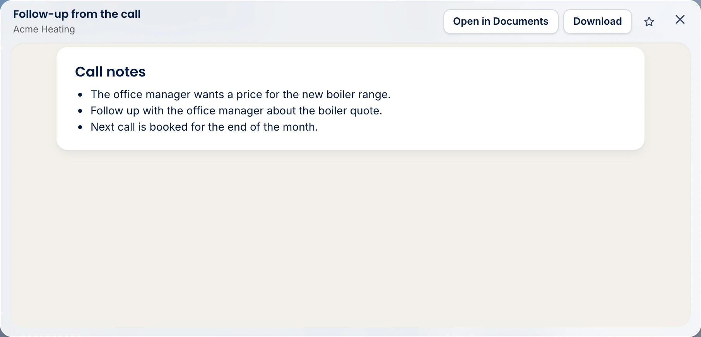

## What it does

The file viewer opens a document, picture or PDF in a wide panel that slides over the screen. You read it without leaving what you were doing.

## Why it helps

- You can check a file in a second and go straight back.
- You don't lose your place in a chat.
- You can download it or pin it from the same spot.

## How to use it

1. Open a file from Documents, Images, a project's **Files** tab or search. On Home, click a file in the **Pinned files** card. In a chat's Files tab, click the file, then press **Open**.
2. Read it. The name is at the top, with where it lives under it.
3. Press **Open in Documents** (or **Open in Images**) to carry on in that app. It opens with the file's details showing.
4. Press **Download** to save a copy.
5. Press the pin to pin the file.
6. Press **Close file**, or press Esc, to go back.

## Good to know

- The screen behind the viewer is paused until you close it.
- Pictures, PDFs, text, Markdown and web pages open inside the app. Word, spreadsheet and slide files don't. They say "This type can't be shown here. Download it to open it."
- A pinned file appears on Home under **Pinned files**. See [Pinned](help:favourites).
- You only see files your role lets you see.

## Try this

Pin a file you open often, then find it under **Pinned files** on Home.
