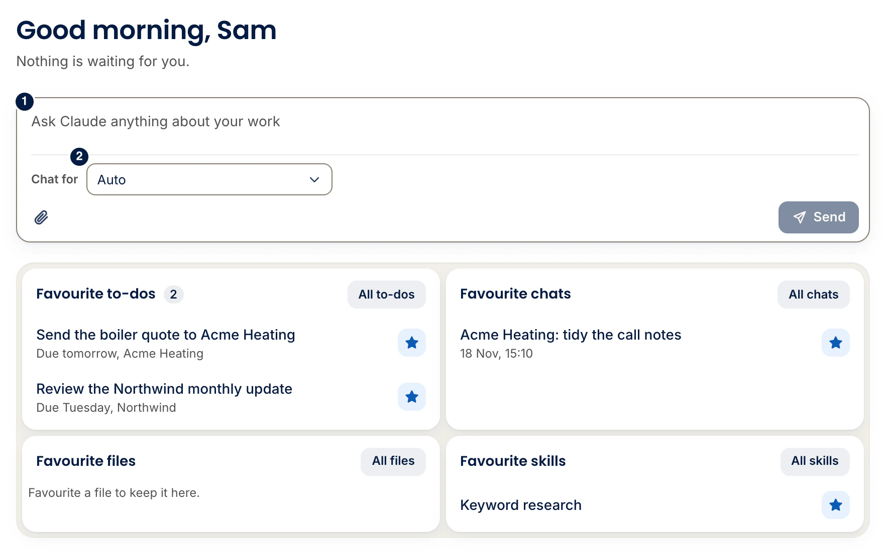

TDS Cortex is where you work with Claude, our AI helper, using everything the agency knows. That shared folder of knowledge is called the Brain. The Brain knows. Cortex gets it done.

## Why it's worth your time

Claude already knows our clients, our notes and our way of doing things. You don't have to explain it all again. You ask in plain words, and Claude does the careful, boring parts for you.

## What you can do in a day

- File call notes. Drop in your notes, and Claude files them where the team can find them.
- Write client reports. Ask for a draft for Acme Heating, then tweak it.
- Draft pages and content. Get a first version in minutes, not hours.
- Hand things over. Pass a to-do to a teammate, and they see it the next time their Brain syncs.
- Share with the team. Anything Claude files in the Brain is there for everyone who needs it. Nobody has to set up access.

Home is where you start. The big box under the greeting is for your message (1). Inside it, at the bottom left, is the client picker (2). Your pinned cards sit underneath.

## Take the tour

The first time you open Cortex after this update, a short tour walks you round. It points at the message box, the rail and search. Press **Next** to move on, **Back** to go back, or **Skip tour** to leave. On the last step, press **Done**. You can take it again from Help with **Take the tour**.

## How to get help

When you aren't typing, press the H key or the ? key to open Help. (This needs **Single-key shortcuts** switched on in Settings (**General** tab). It is on unless you turned it off.) You can also use the Help item on the left-hand rail. It opens on the page for the screen you're on.

## Where to go next

Start with [Home](help:home). Then see how to [talk to Claude](help:talking-to-claude), and how [to-dos](help:todos) and [skills](help:skills) save you time.
