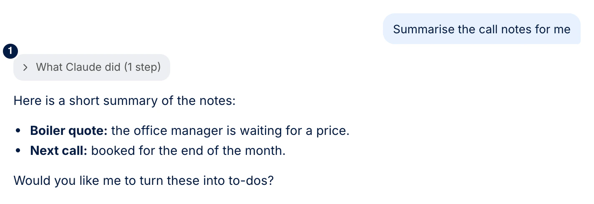

## What it does

Under each reply, Claude keeps a fold called **What Claude did**. It lists the steps Claude took to get your answer.

## Why it helps

- You can see where an answer came from before you rely on it.
- If something looks odd, you can find the step that caused it.
- You don't have to watch Claude work. The detail is there when you want it.

## How to use it

1. Find the line that starts **What Claude did** under a reply. It says how many steps there were, such as "3 steps".
2. Press it to open the fold.
3. Read down the list. It shows each step, and any notes Claude wrote between steps.

While Claude is working, the same line says what it is doing now. If Claude needs you, it says **Waiting for you**.

## Good to know

- If Claude used helpers, their reports are in the fold too. The line counts them, such as "1 helper report". See [Helpers](help:helpers).
- To see the files behind a step, open the [Files tab](help:chat-files).
- The fold only describes what happened. Whether Claude asks before it changes things depends on your settings. See [Approvals and questions](help:approvals-and-questions).

## Try this

After your next reply, open **What Claude did** and look for the first file Claude read.
