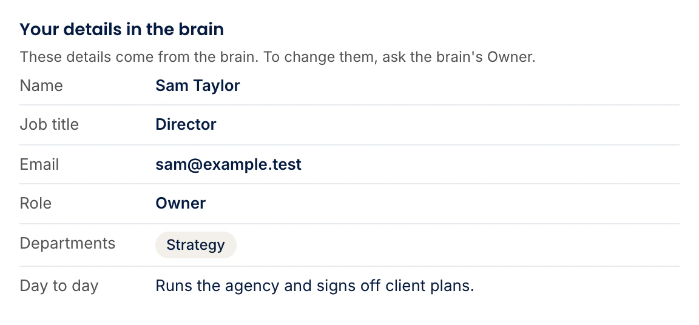

## What it does

Your profile shows the details the Brain holds about you. They come from the team list and your team profile.

## Why it helps

- You can check your name, job title and departments in one place.
- Your role decides what you can change, such as skill levels.
- It shows quickly if the Brain doesn't know you yet.

## How to use it

1. Press your name at the bottom of the rail.
2. Read **Your details in the brain**. You will see your **Name**, **Job title**, **Email**, **Role**, **Departments** and **Day to day**.
3. A grey "Not listed yet" means the Brain has nothing for that line.

## Good to know

- You can't change these details in Cortex. Ask the Brain's owner.
- If you're not on the team list yet, Cortex shows details from your Mac and says so. Ask the owner to add you.
- Your role is Owner, Scout or Team. It decides things such as who can change skill levels.

## Try this

Open your profile and check your **Job title** is right. If it isn't, tell the Brain's owner.
